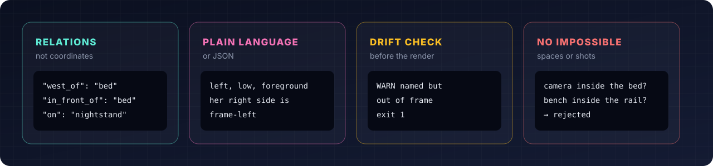
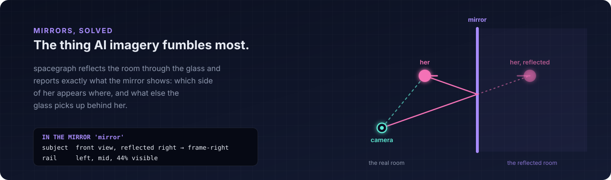
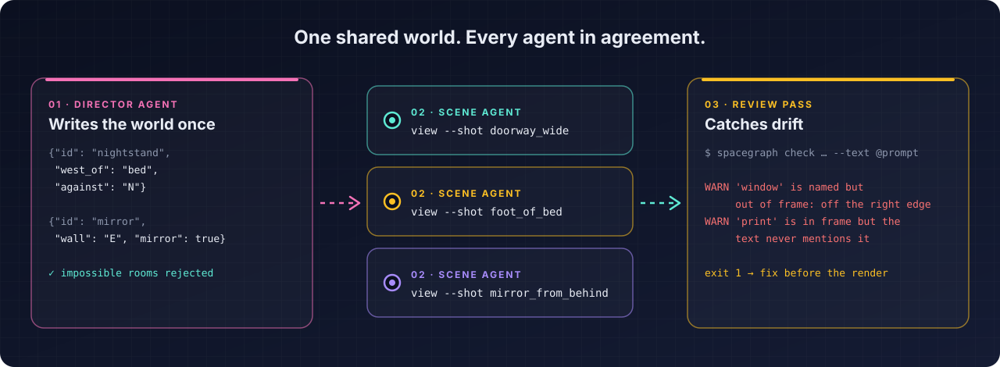

<div align="center">


**Your agents can write a beautiful scene. spacegraph makes sure it's the same room every time.**

[Get started](docs/REFERENCE.md) · MIT licensed

</div>

## The problem

Ask an agent for twelve shots of the same bedroom and you get twelve bedrooms.


## The fix

Describe the space once. Then any agent can point a camera and ask: **"What do I actually see from here?"**






Indoors or outdoors: bedrooms, streets, beaches. No engine, no GPU, no dependencies.

## Built for multi-agent pipelines



## Try it

```bash
pip install git+https://github.com/evolite/spacegraph

spacegraph view  examples/bedroom.json --shot doorway_wide
spacegraph map   examples/bedroom.json --shot doorway_wide
spacegraph check examples/bedroom.json --shot doorway_wide --text @prompt.txt
```

Python 3.10+. Full reference: [docs/REFERENCE.md](docs/REFERENCE.md).

<div align="center"><sub>Diagrams drawn from <code>examples/bedroom.json</code> by <code>docs/images/generate.py</code>.</sub></div>
