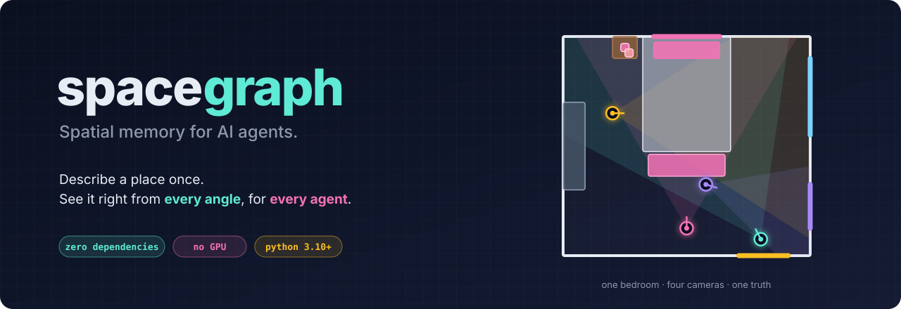
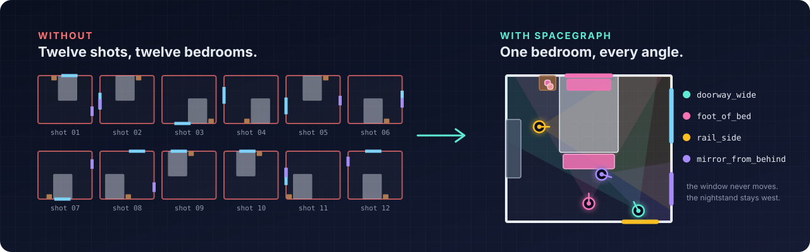
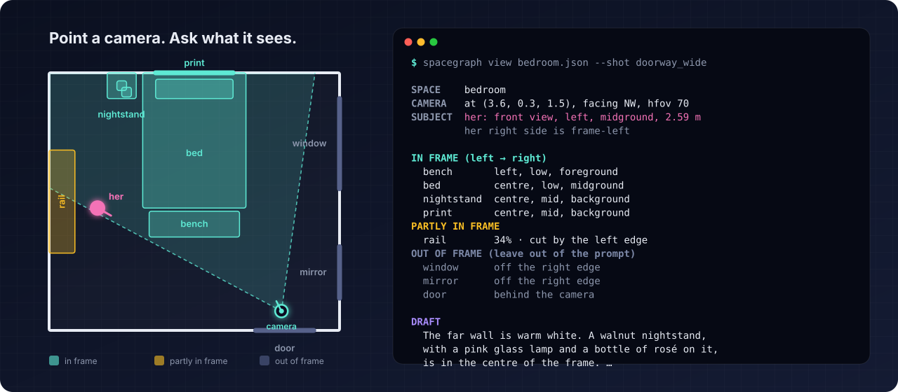

<div align="center">



<br>

**Your agents can write a beautiful scene. spacegraph makes sure it's the same room every time.**

[Get started](docs/REFERENCE.md) · [How it works](#spacegraph-gives-them-a-place-to-remember) · [Pipelines](#made-for-multi-agent-pipelines) · MIT licensed

</div>

---

## The problem every AI storyteller hits

Ask an agent for twelve shots of the same bedroom and you get twelve bedrooms.



The window wanders from wall to wall. The nightstand flips sides. A mirror shows something the room never had. The
lamp that sat on the left in shot two is suddenly on the right, and nobody can say which one is wrong, because the
room never existed anywhere except in the words.

Language models are brilliant at describing a place. They are not built to *remember* one.

## spacegraph gives them a place to remember

Describe a space once, the way a set designer would: *the bed against the north wall, a nightstand to its west, a
tall mirror by the door.* spacegraph turns that into a real, consistent world.

From then on, any agent can step into it, point a camera, and ask a simple question:

> **"What do I actually see from here?"**



And it gets a straight answer: what's in frame and where, what's behind the camera, which way she's facing, what the
mirror reflects. Facts, not guesses. The agent stays free to write however the shot deserves, but it writes from the
same world as every agent before it.

## Built for agents, not just people


- **Speaks the way agents think.** Rooms are described in relationships ("in front of the bed", "beside the window"),
  not coordinates. If an agent can describe a room, it can build one.
- **Answers in plain language.** Every view comes back as a clear, readable report an agent drops straight into its
  reasoning, or as structured data for pipelines.
- **Catches drift before it ships.** Hand it a finished prompt and it points out what doesn't add up: the window
  that can't be seen, the hand on the wrong side, the mirror nobody mentioned.
- **Refuses the impossible.** Furniture inside furniture, a camera inside the bed, a character standing in a
  wardrobe: spacegraph rejects it on the spot, so no agent ever builds on a broken world.
- **Small enough to trust.** No engine, no GPU, no setup. It runs anywhere an agent does.

## Mirrors, done right


Reflections are where AI imagery falls apart. spacegraph works out exactly what a mirror shows, which side of her
lands where in the reflection, and warns you when the camera would see itself.

## Indoors, outdoors, anywhere

A bedroom with a reading nook. A rain-soaked street. A beach where the sea runs to the horizon. If you can describe
the place, spacegraph can hold it steady, shot after shot, agent after agent. Open sides become the backdrop: point
a camera east on the beach and the frame fills with *the sea, calm and turquoise, running to the horizon.*

## Made for multi-agent pipelines


spacegraph shines when many hands touch one story:

1. **A director agent** writes the world once.
2. **Every scene agent** places its camera and reads what's there before it writes a word.
3. **A review pass** checks each finished prompt against the camera and flags anything that drifted.

One shared world. Every agent in agreement. No more continuity errors you only spot after the render.

## Try it in thirty seconds

```bash
pip install git+https://github.com/evolite/spacegraph

spacegraph view examples/bedroom.json --shot doorway_wide     # what the camera sees
spacegraph map  examples/bedroom.json --shot doorway_wide     # top-down ASCII map with the view cone
spacegraph check examples/bedroom.json --shot doorway_wide --text @prompt.txt   # flag drift in a prompt
```

Python 3.10+, standard library only. The full command and scene-file reference is in [docs/REFERENCE.md](docs/REFERENCE.md).

## Who it's for

- **AI image and video pipelines** that need a series, not a single lucky frame.
- **Storyboarding and previs**, where every angle has to cut together.
- **Agent builders** who want their agents grounded in something more solid than the last paragraph they wrote.
- **Anyone tired of rooms that rearrange themselves.**

---

<div align="center">

**Describe it once. See it right from every angle.**

[Get started](docs/REFERENCE.md) · MIT licensed

<sub>The diagrams above are drawn from <code>examples/bedroom.json</code> by <code>docs/images/generate.py</code>.</sub>

</div>
